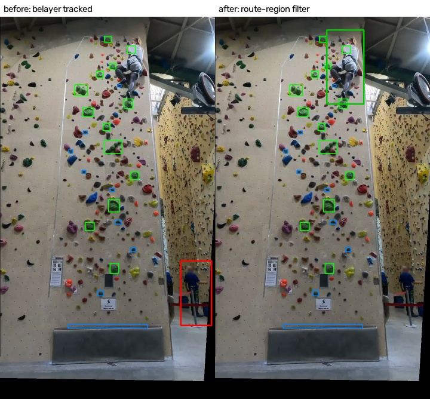
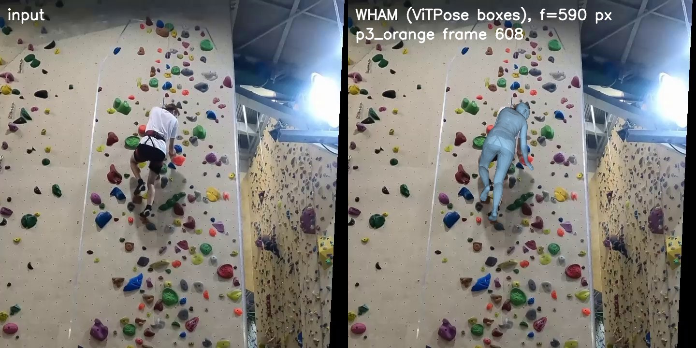
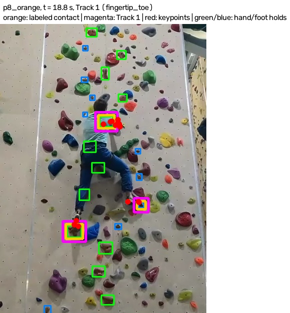
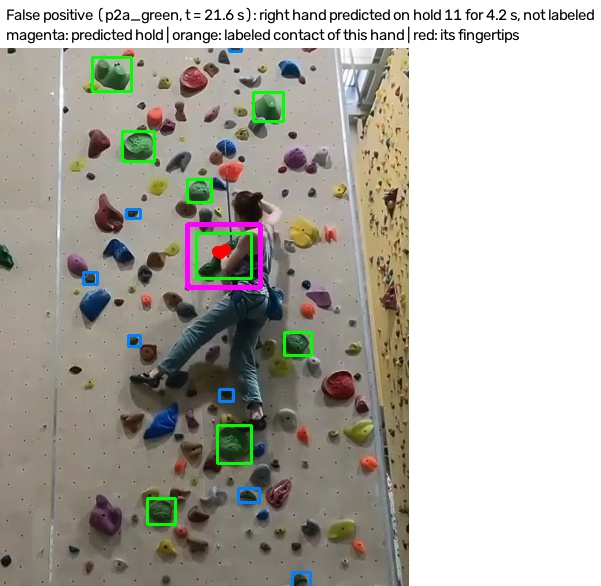
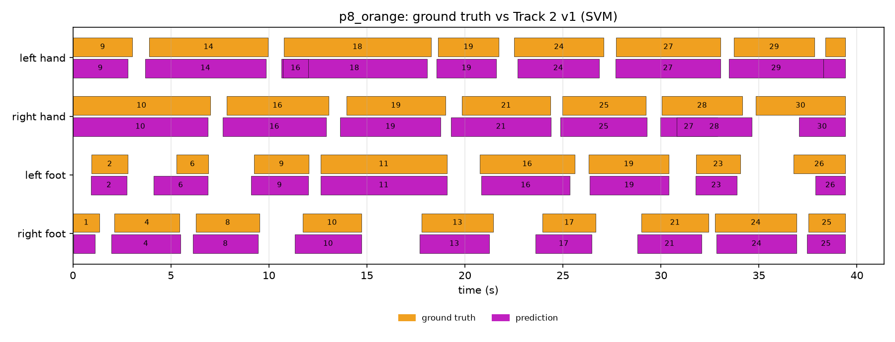

# Hold On — Phase 2 Progress Report

**Hand/Foot–Hold Contact Detection from Monocular Climbing Video**
CS 5330 Pattern Recognition and Computer Vision, Fall 2026 — Team 06: Zongyang Li, Yen-Wei Lin, Jinghong Yang

**Submission links**

| Deliverable | Link |
| --- | --- |
| Prototype and source code (branch `main`; setup and reproduction steps in `README.md`) | https://github.com/zongyang078/HoldOn |
| Demo videos, slides and slide material (folder `phase2_progress/`) | https://drive.google.com/drive/folders/1XWcjto1pSWkWLWmeqXtztriikkjzU9bY |
| Dataset copy and versioned pose files | https://drive.google.com/drive/folders/14LDiwWxDYSHDEanNLgf-o8uWpW3GYr23 |

> Numbers come from `docs/phase2_results.md` (Track 3: §9.6) and `results/tables/track3_wall_pose.md`.

## 1. Overview

Given a climbing video and the hold bounding boxes, we detect **which hand or foot touches which hold,
and when**. Each output is a contact event: limb, hold, start frame, end frame. Today this is done by
manual video review or with force sensors built into the holds, for competition scoring, coaching and
training logs.

2D methods find most contacts but also report false ones: a hand passing in front of a hold looks like a
grasp. Our question is whether temporal and 3D cues reduce these false hand contacts. Three tracks share
the same data, splits and scorer:

1. **Track 1 — classical 2D baseline:** a keypoint near a hold box for long enough is a contact.
2. **Track 2 — learned classifier:** 2D overlap, stillness and temporal-context features → SVM.
3. **Track 3 — 3D pipeline:** WHAM body + wall pose from the bolt holes → 3D limb-to-hold distance.

**Phase 2 delivers** 2D pose for all 22 videos, Track 1 and Track 2 scored with leave-one-participant-out
(LOPO), one shared evaluation module, and the Track 3 setup (WHAM on our climber tracks, wall pose for all
videos, distance code and the first distance files). The first 3D check shows a depth bias, so Track 3 contact
numbers follow in Phase 3.

## 2. System architecture

```
video ──> 2D pose (YOLOX-m → climber → RTMW-x / ViTPose++) ──┬──> Track 1 rule ─────┐
                                                             └──> Track 2 SVM ──────┼──> events.csv ──> one evaluation module
video ──> WHAM body + wall pose ──> 3D distances ───────────────> Track 3 rule ─────┘    (limb, hold,    (P / R / F1, breakdowns)
                                         └── (Phase 3) features for Track 2              start, end)
```

- **One event format and one scorer** for all tracks, so the comparison is fair.
- **Versioned data:** pose and 3D files are exported once in their own environments (GPU / Colab), stored
  under a version name on Google Drive and selected in `configs/paths.yaml`.
- **Code:** reusable modules in `src/holdon/` (data, preprocessing, features, models, training, evaluation,
  visualization); thin `scripts/`; YAML configs; 100 CPU-only unit tests. One branch per member, merged
  through pull requests.

## 3. Implementation

### 3.1 Data and evaluation

- **Data:** The Way Up (Maschek & Schedl, CVPRW 2025): 22 videos (11 climbs × 2 routes, 10 climbers),
  720×1280 at 25 fps, 939 labelled contacts (481 hand, 458 foot).
- **Splits:** LOPO, 10 folds; every tuned value is chosen on the training climbers only.
- **Scoring** (`holdon.evaluation`, learning line): a prediction matches a label only with the same limb
  and hold; greedy matching under temporal IoU (tIoU); precision, recall and F1 at tIoU > 0, ≥ 0.3 and
  ≥ 0.5, macro-averaged over videos. Breakdowns by hands / feet, route, occluded vs visible frames and
  climbing experience (group averages only; a one-person category is merged with its neighbour). The
  scorer was moved unchanged from Track 1 and reproduces its numbers exactly.

### 3.2 2D pose pipeline (2D line)

- **Climber selection:** YOLOX-m detects people; the climber is the person with ≥ 50% of the box inside
  the route region (hold boxes + 80 px), tracked by IoU. Without this filter the tracker jumped to the
  belayer (Figure 1).
- **Pose:** RTMW-x (133 keypoints, incl. fingertips and toes) and ViTPose++-H (17 keypoints, the paper's
  baseline). All 22 videos with both models took 2 h 45 min on a GCP T4.
- **Validation:** in labelled contact frames, the wrist or ankle is within 40 px of the labelled hold in
  95.7% of detected frames (89.3% before the climber filter).


*Figure 1. Without the route-region filter the tracker jumps to the belayer (left); with it, it stays on the climber (right).*

### 3.3 Track 1 — classical 2D baseline (2D line)

- **Rule:** low-confidence keypoints are dropped, gaps ≤ 5 frames interpolated, tracks median-smoothed. A
  limb touches the nearest hold whose box is within `distance_px` of any of its keypoints; runs separated
  by short gaps are merged, and contacts shorter than `min_duration_s` are dropped.
- **Keypoints:** wrist/ankle (as in The Way Up) or fingertip/toe (5 fingertips; big toe, small toe, heel).
- **Tuning:** each fold picks the best of 480 settings on its training climbers. Fingertip/toe chose
  20 px and a **2.0 s** minimum duration (every fold); the paper's 0.5 s rule is far too short here.
- **Demo videos** (`scripts/make_overlay.py`, held-out predictions): a whole climb of `p8_orange`, and the
  false positive of Figure 3 in motion, on the team Drive (`deliverables/phase2_progress/`).

### 3.4 Track 2 v1 — learned classifier (learning line)

- **Candidates:** per frame and limb, only holds within 80 px that are among the 3 nearest: 395 k rows
  instead of 4.0 M, keeping 91.8% of the labelled contact frames.
- **Features (36):** distances of fingertips/toes and wrist/ankle to the box, inside flags and
  confidences (2D overlap); keypoint speed (stillness); rolling mean and minimum over ±2 / ±6 / ±12 frames
  (context).
- **Classifier and decoding:** Nystroem RBF kernel + linear SVM with balanced classes. Per frame, the
  limb's best-scoring hold is a contact above a threshold; Track 1's duration and gap rules then form
  events. Threshold, duration and gap are tuned on out-of-fold scores of the training climbers only.
  A full LOPO run takes about 3 min on a laptop CPU.

### 3.5 Track 3 — 3D pipeline (3D line)

- **3D body:** WHAM's own tracker loses the climber high on the wall (at most 26% of `p3_orange`).
  `external/wham/run_wham.py` feeds WHAM the climber keypoints from the 2D line instead and keeps the rest
  of WHAM unchanged (HMR2 features, WHAM network, SMPL; static camera). Coverage on `p3_orange`: **96%**.
- **Wall pose:** 20 of the 22 bolt-hole files list the top two points in swapped order; after repairing
  it, one focal length fits all 22 videos: **590 px**, median bolt-hole error **0.86 px** (WHAM's default
  1469 px: about 10 px). WHAM runs with this focal length, so body and wall share one camera. Holds mapped
  onto the wall measure 10 × 9 cm (median), a plausible scale.
- **3D distance:** smallest distance from the hand or foot contact vertices (palm and fingers; sole, heel,
  toes) to each hold's box on the wall plane, written in the shared distance format for Track 3's contact
  rule and, in Phase 3, Track 2's features. Code and 17 unit tests are done; first files: `p3_orange`, `p8_orange`.
- **First check (`p3_orange`, `p8_orange`, labelled contact frames):** the labelled hold is the nearest
  hold in only 3–27% of frames per limb; on `p3_orange` a frame-level "nearest hold within a threshold"
  rule reaches F1 ≈ 0.14 at any threshold from 0.05 to 0.5 m. The error is systematic: the nearest hold is
  almost always one *higher* on the wall. Cause, confirmed on the WHAM files: WHAM's absolute depth places
  the body behind the wall plane (pelvis 0.34 m and 0.63 m behind it), and with the camera 2.6 m away
  looking up, a depth error moves the body up the wall. The distance files are therefore not
  yet used by Track 2 (`versions.distance3d` stays unset).


*Figure 5. WHAM on p3_orange (frame 608), driven by our climber keypoints and the fitted 590 px focal length: input (left), SMPL body (right). The body aligns well in 2D; its depth relative to the wall is the open problem.*

## 4. Tools and libraries

Python 3.14; OpenCV 5 (video I/O, drawing, homography); NumPy; matplotlib; PyYAML; rtmlib 0.0.16
with ONNX Runtime GPU 1.32 (YOLOX-m, RTMW-x); HuggingFace transformers 5.23 with PyTorch 2.15
(ViTPose++-H); scikit-learn (Nystroem, LinearSVC); WHAM + SMPL (Colab); ffmpeg; pytest; Google Cloud
(n1-standard-4, T4); GitHub; Google Drive.

## 5. Initial results

### 5.1 Results

F1 (precision / recall / **F1** for the main rows), macro over 22 videos, held-out climbers only.

| Setting | tIoU > 0 | tIoU ≥ 0.3 | tIoU ≥ 0.5 |
| --- | --- | --- | --- |
| **Track 2 v1 (SVM), all limbs** | 0.947 / 0.887 / **0.915** | 0.928 / 0.869 / **0.896** | 0.883 / 0.828 / **0.853** |
| — hands | 0.923 / 0.883 / **0.899** | 0.891 / 0.854 / **0.869** | 0.829 / 0.796 / **0.809** |
| — feet | 0.973 / 0.895 / **0.931** | 0.967 / 0.890 / **0.925** | 0.945 / 0.870 / **0.904** |
| Track 1 fingertip/toe, all limbs | 0.890 / 0.848 / **0.864** | 0.869 / 0.827 / **0.844** | 0.814 / 0.773 / **0.790** |
| — hands | 0.834 / 0.832 / **0.828** | 0.799 / 0.796 / **0.792** | 0.726 / 0.721 / **0.719** |
| — feet | 0.959 / 0.868 / **0.908** | 0.956 / 0.865 / **0.905** | 0.923 / 0.835 / **0.874** |
| Track 1 ViTPose++-H wrist/ankle (paper setting) | **0.795** | **0.770** | **0.706** |
| Untuned 0.5 s rule, fingertip/toe | **0.631** | **0.426** | **0.254** |
| Track 3 (first check, frame level) | `p3_orange` F1 ≈ 0.14; labelled hold nearest in 3–27% of contact frames (2 videos); depth bias, §3.5 | | |

For context only: The Way Up reports about 86.6% (tIoU > 0) and 69% (tIoU > 0.5) *accuracy* for its
ViTPose baseline, a different metric from our F1.

### 5.2 Findings

1. **Track 2 reduces false hand contacts (the research question).** Hand precision at tIoU > 0 rises from
   0.834 to 0.923; false hand contacts drop from 91 to 38 over the 22 videos while correct ones rise from
   401 to 422 of 481. All-limb F1 is 0.05–0.06 higher than Track 1 at every threshold, and occluded hand
   frames are recalled better (0.872 vs 0.779).
2. **Toe keypoints fix the feet.** Track 1 foot F1 rises from 0.652 (ankle) to 0.908 (toes): standing on
   the toes, the ankle lies outside the foothold box.
3. **Tuning matters for the 2D rule.** LOPO tuning lifts Track 1 from F1 0.631 (untuned 0.5 s rule) to
   0.864, and every fold chose a 2.0 s minimum duration. The cost: 137 of 939 contacts (14.6%) are shorter
   and cannot be found. Track 2 needs only 1.0 s.
4. **Accurate intervals.** Matched contacts overlap their labels with mean tIoU 0.836 (Track 1) and 0.882
   (Track 2).
5. **The 3D setup runs, but depth is not yet usable.** Our climber tracks raise WHAM's coverage from 26%
   to 96%, and the fitted focal length places the wall within 0.86 px of the bolt holes in all 22 videos.
   The first distance files (2 videos), however, pick the labelled hold in only 3–27% of contact frames:
   WHAM places the body 0.3–0.6 m behind the wall (§3.5).


*Figure 2. Track 1 on p8_orange. Orange: labelled contact holds; magenta: Track 1; red: fingertips and toes. All four limbs are on the correct holds.*


*Figure 3. Typical false positive (p2a_green, 21.6 s): the right hand rests in front of hold 11 for 4.2 s without holding it. Tracks 1 and 2 both report a contact; telling "on" from "in front of" needs depth.*


*Figure 4. Labelled (orange) vs Track 2 (magenta) contacts per limb on p8_orange; numbers are hold ids.*

### 5.3 Against the Phase 1 objectives

| Objective | Status after Phase 2 |
| --- | --- |
| Contact events from monocular video | Done for Tracks 1 and 2, one shared format and scorer |
| Reproduce the 2D baseline of The Way Up | Done (ViTPose wrist/ankle, F1 0.795 at tIoU > 0) |
| Fewer false hand contacts with temporal cues | Shown: 91 → 38 with Track 2, recall kept |
| Fewer false hand contacts with 3D cues | Pipeline runs; depth bias to fix first, numbers in Phase 3 |

## 6. Challenges and planned improvements

| Line | Challenge | Status |
| --- | --- | --- |
| 2D | The tracker jumped to the belayer when the climber was missed | Solved with the route-region filter |
| 2D | The climber is not detected high on the wall: 20–30% of contact frames in three videos | Open (Phase 3) |
| Learning | A still hand in front of a hold remains a false positive (Figure 3) | Needs the 3D distances |
| Learning | 8.2% of contact frames cannot be predicted (6.3% without pose, 2.0% hold not a candidate) | Open |
| 3D | WHAM's own tracker loses the climber (≤ 26% of frames) | Solved: our climber keypoints, 96% |
| 3D | Bolt holes in swapped order in 20 of 22 files; camera intrinsics unknown | Solved: order repaired, one fitted focal length (0.86 px) |
| 3D | WHAM's absolute depth puts the body 0.3–0.6 m behind the wall; labelled hold nearest in only 3–27% of contact frames | Open: anchor the body depth to the wall (fallback: 2.5D distance in the wall plane) |

**Phase 3:** anchor WHAM's depth to the wall (keep each point's 2D projection, rescale along the viewing
rays), then run WHAM and the 3D distances on all 22 videos and score Track 3; add the 3D distances to
Track 2 and try a temporal model (GRU / 1D-CNN) with an ablation of each cue; combine the best hand and
foot keypoints and reduce missed climber frames; test on our own Kilter board clips; compare the three
tracks on the same splits.

## 7. Contributions

| Member | Line | Phase 2 work |
| --- | --- | --- |
| Zongyang Li | 2D line | Data and Drive distribution; 2D pose export (RTMW, ViTPose++) with climber selection on GCP and its validation; Track 1 and its fingertip/toe variant with LOPO tuning; first scoring code; documentation; figures, demo videos and slide material |
| Yen-Wei Lin | Learning line | Evaluation module (shared scorer and breakdowns); Track 2 v1 (candidates, features, SVM, LOPO tuning) and its results; progress report draft; presentation slides |
| Jinghong Yang | 3D line | WHAM runner on the 2D line's climber keypoints; bolt-hole repair and shared focal length for the wall pose of all 22 videos; 3D limb-to-hold distance module with unit tests; first distance files and the depth-bias diagnosis; WHAM Colab set-up |
